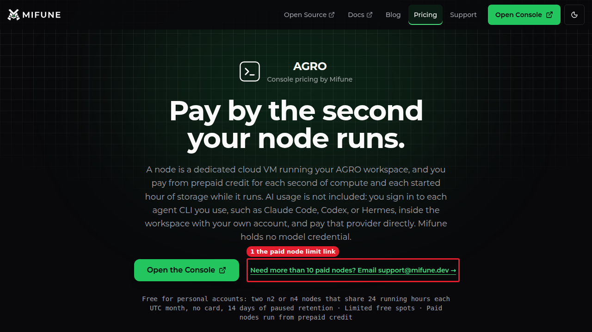
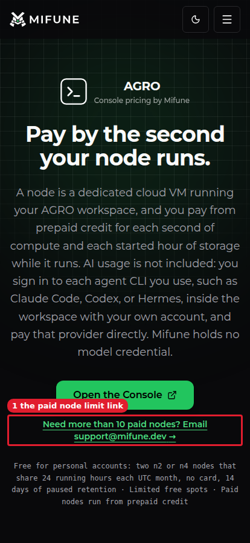
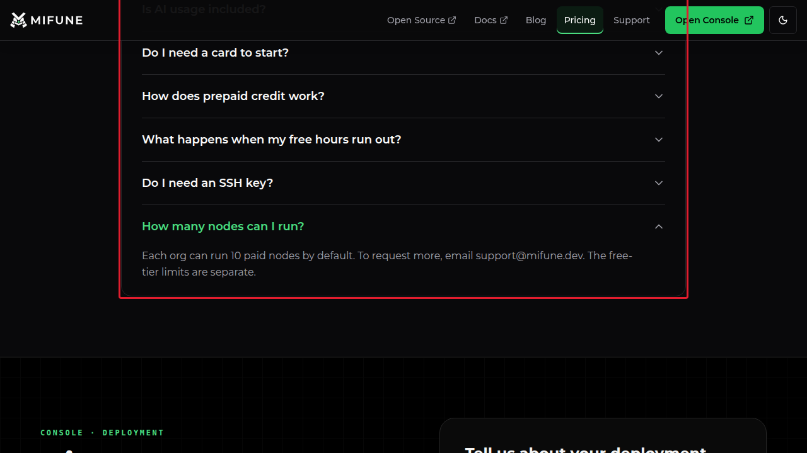

# Paid node limit copy

Lane N captured this evidence on 2026-11-17 at commit `b76318f`. The advisor built the site from a `git archive` export on `agro-sbx-dev-001` and served the build with `next start` on port 3191.

| Check | Result |
|---|---|
| `npm run lint` | exit 0 |
| `npm run build` | exit 0 |
| `cmp` of the regenerated `public/llm.txt` against the committed file | identical |
| FAQPage JSON-LD in `pricing.html` | holds "Each org can run 10 paid nodes by default. To request more, email support@mifune.dev. The free-tier limits are separate." |
| Mobile `/pricing` at 414x896 | `scrollWidth` 414 |

Callouts: 1 is the paid node limit link.

Callouts: 1 is the paid node limit link.

Callouts: 1 is the node limit answer.
