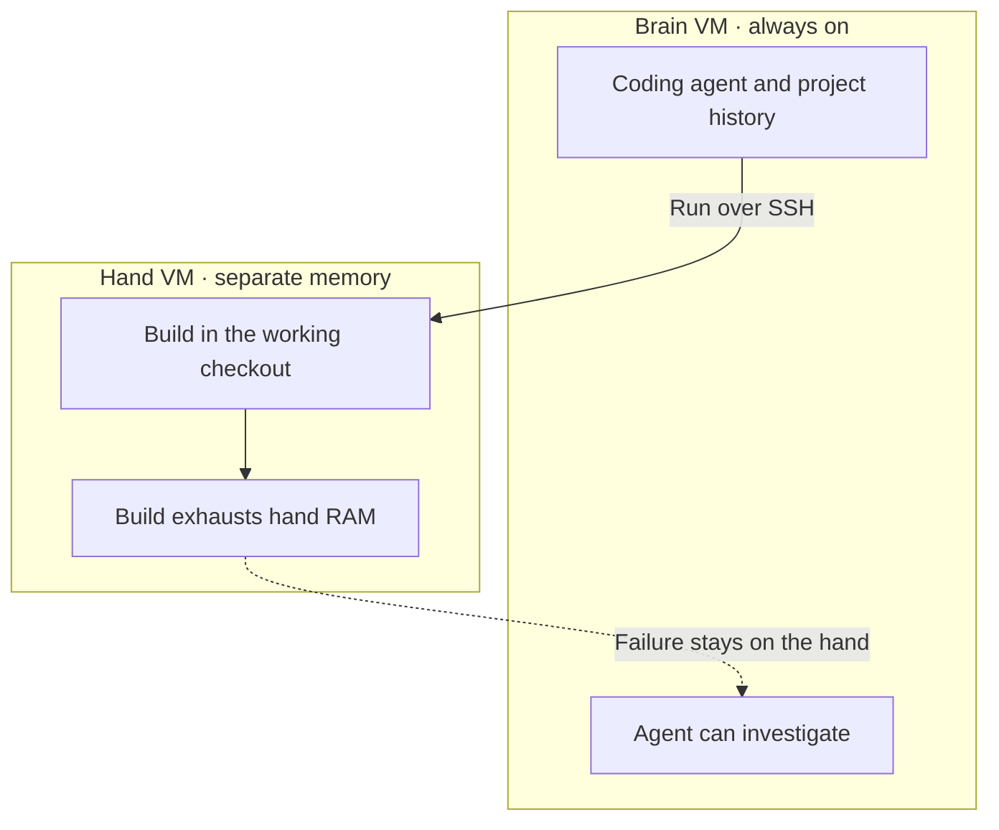
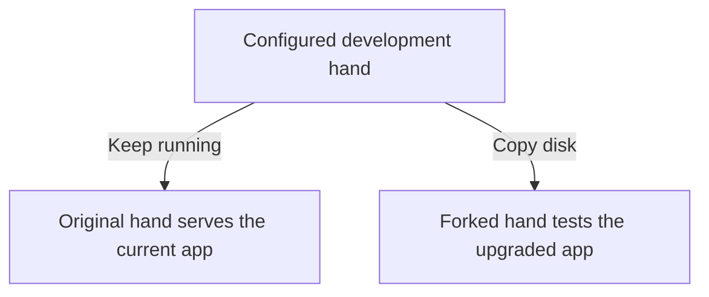
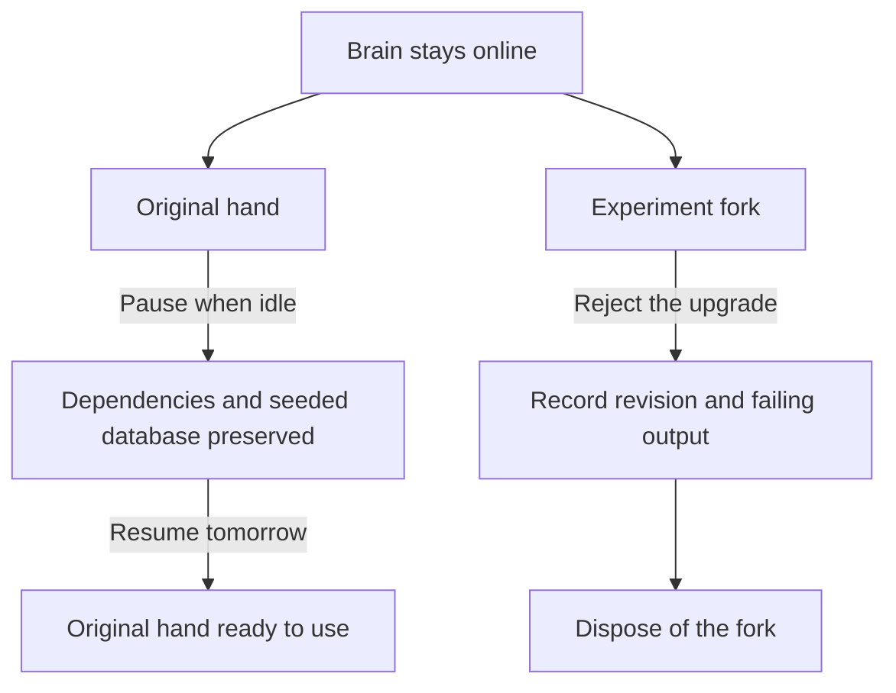

A coding session should outlive its sandbox. In Mifune, the **brain** is the always-on VM that runs your coding agents and keeps the project history. A **hand** is a sandbox VM that holds the working checkout and dependencies. Agents on the brain send commands over SSH to build, test, and run the app on the hand.

Each machine has its own memory and lifecycle. If a build exhausts the hand’s RAM, the agent on the brain can still investigate. You can fork a configured hand to try a change, pause one you’ll reuse, or dispose of one that’s finished. The same agent session can work with the next hand.

The names come from Anthropic’s design for Claude Managed Agents, where the brain is Claude and its harness and the hands are the tools and sandboxes it uses. [Scaling Managed Agents: Decoupling the brain from the hands](https://www.anthropic.com/research/managed-agents)

## Fork a hand to try a library upgrade

Suppose your development app is running on a hand with its dependencies installed and database seeded. To try a library upgrade, authorize the brain to fork that hand. Leave the original serving the current app and install the new library on the copy. Each hand has its own checkout and memory allocation. The fork copies the source disk, including credentials stored there. AGRO manages this lifecycle on Mifune Console or exe.dev. [Hand lifecycle](https://github.com/mifunedev/agro/blob/development/docs/lifecycle-commands.md#hands-from-a-brain-agro-hands)

*Both versions can run at the same time. Each hand has its own checkout and RAM allocation.*

Sometimes a Git worktree is enough. AGRO’s current guide assigns separate hands to parallel agents on the same project. On the brain, a supervisor manages advisor sessions in Herdr. One workflow I’d try is to have an advisor delegate edits to workers, each using a separate worktree on a shared hand. Each worker can build and test in its own worktree. The advisor queues final verification in the repo’s primary checkout and checks each integrated commit in turn. On a small hand, scheduling one heavy job at a time leaves capacity for workers to keep editing. [AGRO hands guide](https://github.com/mifunedev/agro/blob/development/.agro/skills/sandbox/references/hands.md#choose-when)

For the library upgrade, I’d use a worktree if all I needed were separate edits. I’d fork the hand if I needed both versions of the app running independently, or if a second machine could finish a blocking test sooner than waiting for the first.

## Dispose of the experiment. Pause the workspace you’ll reuse.

Suppose the tests show the new library breaks a feature you depend on, and you decide to stay on the current version. Record the tested revision and failing output in the issue, then dispose of the fork. If you decide to fix the incompatibility instead, keep working on the fork and rerun the test there.

At the end of the day, the original development hand is idle. You’ll need its installed dependencies and seeded database for tomorrow’s work, so pause it. When you’re ready to continue, resume that hand from the always-on brain.

[Run AGRO on Mifune Console](/blog/run-agro-on-mifune-console)
