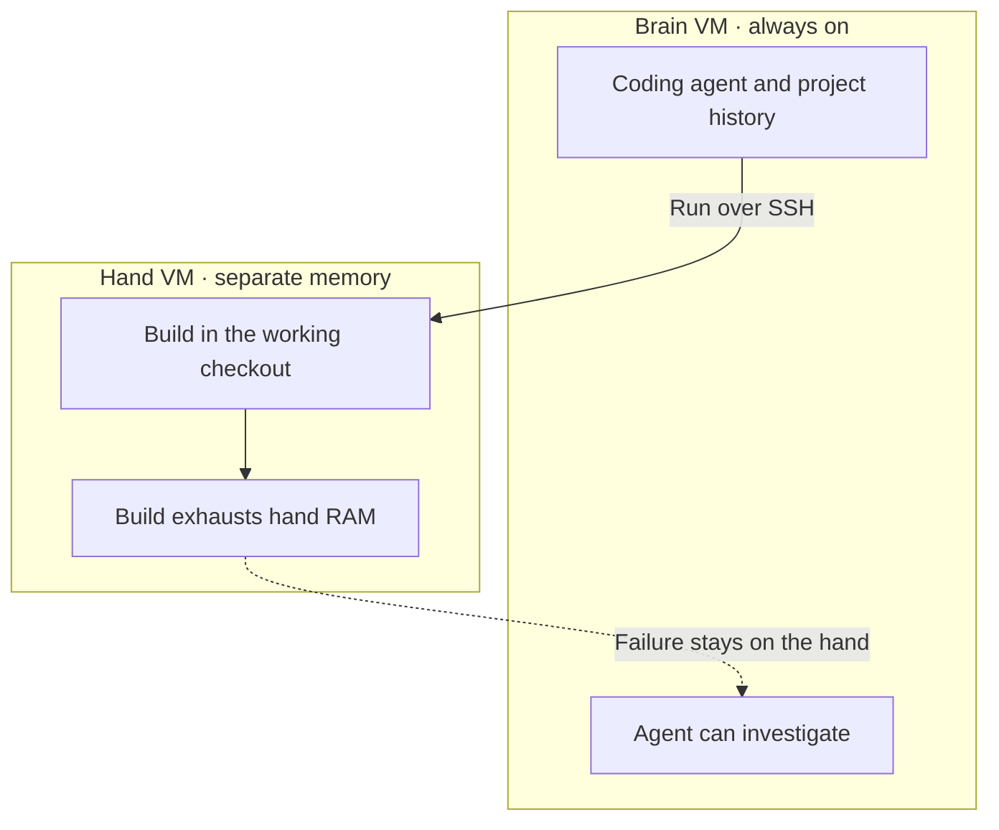
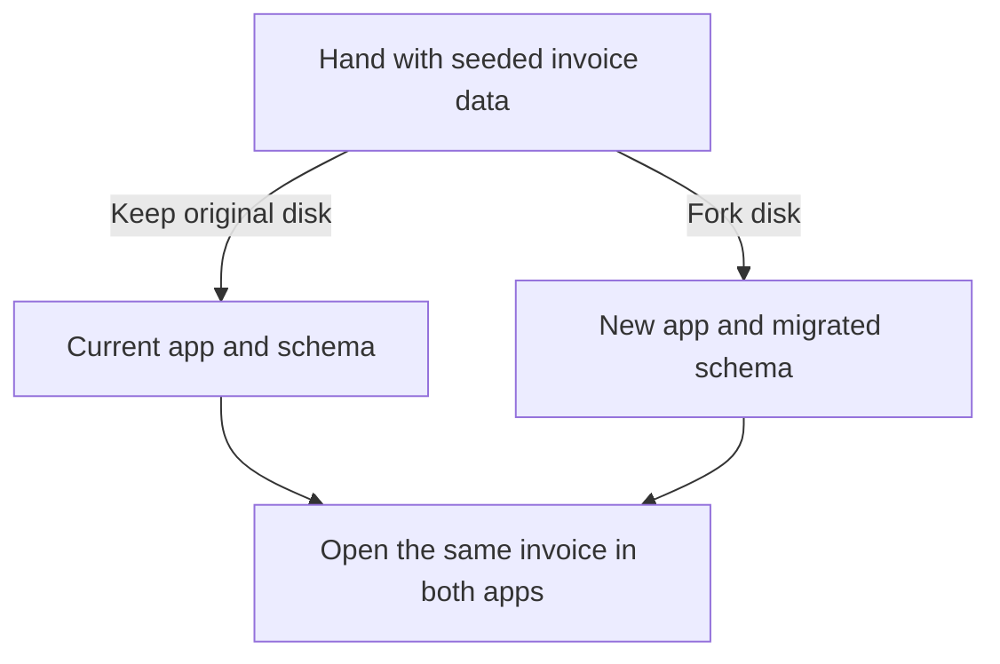
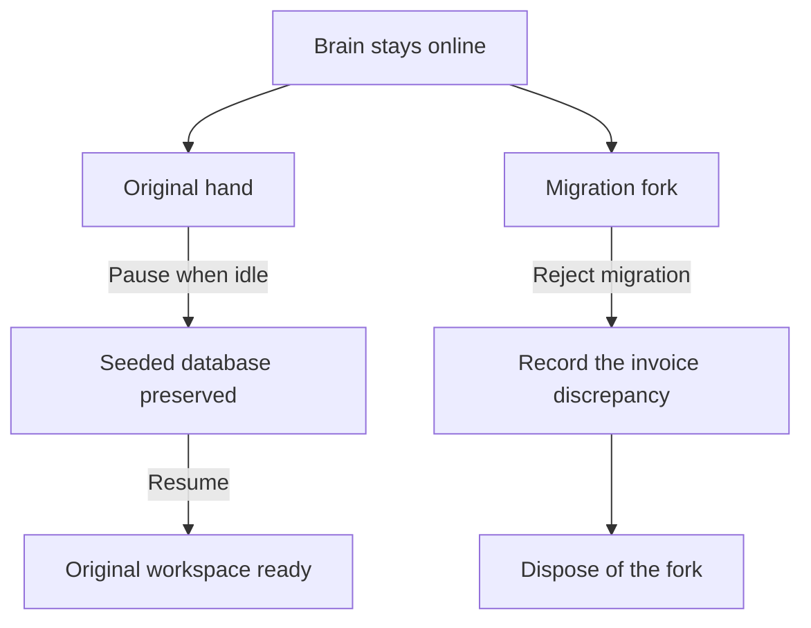

A coding session should outlive its sandbox. In Mifune, the **brain** is the always-on VM that runs your coding agents and keeps the project history. A **hand** is a sandbox VM that holds the working checkout and dependencies. Agents on the brain send commands over SSH to build, test, and run the app on the hand.

Each machine has its own memory and lifecycle. If a build exhausts the hand’s RAM, the agent on the brain can still investigate. You can fork a configured hand to try a change, pause one you’ll reuse, or dispose of one that’s finished. The same agent session can work with the next hand.

The names come from Anthropic’s design for Claude Managed Agents. In that design, the brain is Claude and its harness, and the hands are the tools and sandboxes it uses. [Scaling Managed Agents: Decoupling the brain from the hands](https://www.anthropic.com/research/managed-agents)

## Rehearse a database migration on a fork

A migration can finish successfully and still mark a paid invoice as unpaid. Suppose you’re changing how your app stores payment status. Pick a paid invoice in the hand’s seeded development database. Open the invoice in the app and record its ID, line items, and $120 total. That gives you a baseline you can check after the migration.

Stop writes and shut down the hand’s local database cleanly. With your approval, the brain forks the hand, copying its disk, including the database files and any credentials stored there. Start each hand’s database and point each app at its own local copy. On the fork alone, apply the migration and run the new app revision. AGRO manages hands on Mifune Console or exe.dev. [Hand lifecycle](https://github.com/mifunedev/agro/blob/development/docs/lifecycle-commands.md#hands-from-a-brain-agro-hands)

Open the recorded invoice ID on both hands. Do the line items still match? Does the migrated app still show $120 and **Paid**? If the total matches but the status reads **Unpaid**, you’ve found a regression that a row-count check would miss.

A Git worktree gives a worker a separate checkout. It doesn’t copy the database that checkout connects to. I’d use worktrees to write the migration and its tests, then fork the hand when I need both database states side by side.

AGRO’s current guide assigns separate hands to parallel agents on the same project. One workflow I’d try has an advisor in Herdr delegate edits to workers on the brain. Each worker uses its own worktree on a shared hand. Workers can build and test in those worktrees. The advisor queues final verification in the repo’s primary checkout and checks each integrated commit in turn. On a small hand, running one heavy job at a time leaves room for workers to keep editing. [AGRO hands guide](https://github.com/mifunedev/agro/blob/development/.agro/skills/sandbox/references/hands.md#choose-when)

## Dispose of the rehearsal. Pause the workspace you’ll reuse.

If you reject the migration, record the tested revision, the invoice ID, and the expected and observed values in the issue. Then dispose of the fork. If you pursue a fix, use the original as your baseline for another rehearsal.

At the end of the day, pause the original development hand. When you need the seeded database again, resume that hand from the always-on brain.

[Run AGRO on Mifune Console](/blog/run-agro-on-mifune-console)
